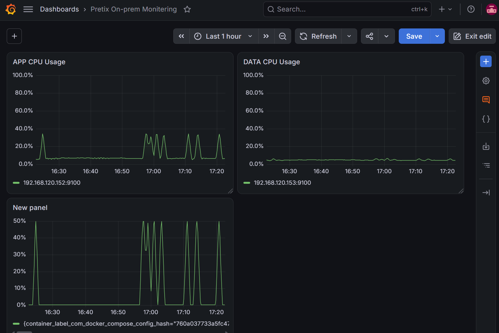

# KT Cloud Basic Cloud Project

마감·예약형 서비스의 순간 트래픽 증가 상황을 가정하여, 온프레미스 Pretix의 처리 한계를 측정하고 AWS로 트래픽을 확장(Cloud Burst)했을 때 성능이 어떻게 달라지는지 검증하는 개인 실습/팀 프로젝트 기록 저장소입니다.

> 실제 상용 서비스의 내부 구조나 트래픽을 재현하는 것이 아니라, 마감·예약형 서비스에서 착안한 실습용 시스템입니다.

## 자료 바로가기

| 구분 | 기록 |
|---|---|
| 설계 및 진행 | [아키텍처](docs/architecture.md) · [진행 기록](docs/progress.md) · [다음 작업](docs/next-steps.md) |
| 부하 테스트 | [테스트 계획](docs/test-plan.md) · [10/10 측정 결과](load-test/results/2026-10-10-hey-results.md) · [결과 요약](load-test/results/summary.md) · [팀 측정](load-test/results/team-c5-initial.md) |
| 모니터링 | [Grafana 설정](monitoring/grafana/README.md) · [Prometheus 설정](monitoring/prometheus/prometheus.yml) · [팀 모니터링](docs/team-rocky-monitoring.md) |
| 문제 해결 및 확장 | [트러블슈팅](docs/troubleshooting.md) · [AWS 계획](aws/README.md) · [k6 계획](load-test/k6/README.md) |

### 모니터링 화면



[APP/DATA CPU 화면](images/grafana-app-data-cpu.png) · [Prometheus Target 상태](images/prometheus-targets.png)

## 핵심 목표

- 온프레미스 Pretix 처리 한계 측정
- `hey`를 이용한 단계별 부하 테스트
- Prometheus + Grafana 기반 시계열 모니터링
- Node Exporter + cAdvisor로 VM/컨테이너 자원 분리 관찰
- Nginx `max_conns` + AWS ALB `backup` 기반 Cloud Burst 검증
- WireGuard 기반 온프레미스-AWS 데이터 경로 유지
- Before / After 동일 부하 비교
- 향후 k6, Loki/Alloy, CloudWatch, ASG, Terraform으로 확장

## 현재 개인 실습 구조

```text
Windows Load PC
  └─ hey (향후 k6)
        |
        v
onprem-app 192.168.120.152
  ├─ Nginx :80
  │    ├─ hybrid access log
  │    ├─ max_conns (한계 측정 시 임시 제거)
  │    └─ AWS ALB backup (AWS 준비 전 주석)
  ├─ Pretix
  │    └─ cpus: "0.5"  # 데모용 CPU 제한
  ├─ Node Exporter :9100
  └─ cAdvisor      :8080
        |
        v
onprem-data 192.168.120.153
  ├─ PostgreSQL :5432
  ├─ Redis      :6379
  ├─ WireGuard  10.10.0.2/24
  ├─ Node Exporter :9100
  └─ cAdvisor      :8080

monitoring 192.168.120.154
  ├─ Prometheus :9090
  └─ Grafana    :3000
```

## 2026-10-10 현재 진행 상태

- [x] APP / DATA VM 분리
- [x] Pretix / Nginx / PostgreSQL / Redis 구성
- [x] Pretix `cpus: "0.5"` 적용 확인
- [x] Nginx hybrid log / `X-Served-By` 적용
- [x] Prometheus / Grafana 구성
- [x] APP / DATA Node Exporter + cAdvisor 구성
- [x] Prometheus target 4개 모두 `UP`
- [x] Grafana APP CPU / DATA CPU / Pretix CPU 시각화
- [x] `hey` c=5/10/20/30/40 한계 측정
- [x] c=40에서 p95 2초 초과 재현
- [ ] `max_conns` 후보 25~28 검증
- [ ] AWS ALB / Target Group / ASG 연결
- [ ] WireGuard 경유 AWS Pretix → 온프렘 DB/Redis 검증
- [ ] 동일 부하 Before / After 비교
- [ ] k6 최종 하이브리드 부하 시나리오
- [ ] Loki + Alloy 로그 시각화

## 1차 부하테스트 요약

최신 재측정 기준 c=20~40과 최초 c=5~10 결과를 합친 값입니다.

| c | RPS | Average | p95 | p99 | HTTP 200 | Timeout | 판정 |
|---:|---:|---:|---:|---:|---:|---:|---|
| 5 | 39.66 | 0.118s | 0.196s | 0.272s | 2,382 | 1 | 정상 |
| 10 | 40.01 | 0.248s | 0.790s | 0.901s | 2,429 | 0 | 정상 |
| 20 | 46.16 | 0.432s | 0.707s | 0.903s | 2,790 | 0 | 정상 |
| 30 | 33.04 | 0.890s | 1.811s | 3.689s | 2,068 | 0 | 한계 근접 |
| 40 | 34.39 | 1.124s | 2.990s | 3.306s | 2,106 | 3 | 한계 초과 |

c=40은 이전 측정에서도 p95 3.899s가 관찰되어, 현재 실습 환경에서는 c≈40 부근을 1차 한계 구간으로 판단합니다. `hey -c`와 Nginx `max_conns`는 동일 개념이 아니므로 `max_conns=25~28`은 **초기 후보값**이며 실제 ALB 연결 후 재검증해야 합니다.

## 폴더 구조

```text
ktcloud-basic-cloud-project/
├── README.md
├── .gitignore
├── AGENTS.md
├── CODEX_PROMPT.md
├── docs/
│   ├── architecture.md
│   ├── progress.md
│   ├── test-plan.md
│   ├── troubleshooting.md
│   ├── team-rocky-monitoring.md
│   └── next-steps.md
├── onprem/
│   ├── app/
│   │   ├── docker-compose.example.yml
│   │   └── nginx.hybrid.example.conf
│   └── data/
│       └── README.md
├── monitoring/
│   ├── agent-app.compose.yml
│   ├── agent-data.compose.yml
│   ├── docker-compose.yml
│   ├── prometheus/prometheus.yml
│   └── grafana/README.md
├── load-test/
│   ├── commands.md
│   ├── results/2026-10-10-hey-results.md
│   └── k6/README.md
├── aws/
│   └── README.md
├── images/
└── scripts/
    └── init-git.sh
```

## 보안 주의사항

아래 값은 절대 GitHub에 커밋하지 않습니다.

- AWS Access Key / Secret Key
- WireGuard Private Key
- DB 비밀번호
- `.env`
- `pretix.cfg`
- `*.pem`, `*.key`
- 실제 secret/credential 파일

공인 IP, 내부 IP, 공개키, 리소스 ID는 비밀값은 아니지만 문서 공개 범위를 고려하여 필요할 때만 기록합니다.

## Codex로 GitHub 업로드

이 폴더를 Codex에서 열고 다음과 같이 요청합니다.

> `CODEX_PROMPT.md`와 `AGENTS.md`를 읽고, 이 폴더를 새 GitHub 저장소 `ktcloud-basic-cloud-project`로 생성해서 업로드해줘.

Codex는 업로드 전에 민감정보를 검사하고, Git 초기화 → 커밋 → 원격 저장소 생성/연결 → `main` push 순서로 작업하도록 지침을 포함하고 있습니다.
